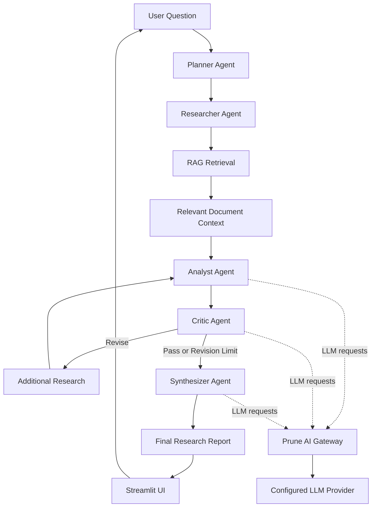

# Autonomous Research & Intelligence Agent

An AI-powered research assistant that uses multiple specialized agents to plan research, retrieve relevant information, analyze findings, review answers, and generate a final response. Built with LangGraph, Retrieval-Augmented Generation (RAG), ChromaDB, Streamlit, and Prune as the LLM gateway.

## Overview

Finding reliable information and turning it into a useful answer often requires multiple steps. This project explores how an AI agent can break down a question, retrieve relevant context, analyze evidence, review its response, and produce a structured final answer.

The system combines a multi-agent workflow with a local vector database for document retrieval and Prune for routing LLM requests.

## Key Features

* **Multi-Agent Workflow:** Separate agents handle planning, research, analysis, critique, and synthesis.
* **RAG Pipeline:** Retrieves relevant information from local documents to support responses with context.
* **Vector Search:** Uses ChromaDB to store and retrieve document chunks.
* **Iterative Review:** A critic agent evaluates the draft and can request additional research when necessary.
* **Prune Integration:** Routes LLM requests through Prune's AI gateway.
* **Interactive Interface:** Provides a Streamlit interface for submitting research questions and viewing results.
* **Mock Testing Mode:** Supports testing the workflow without relying on live LLM responses.
* **Workflow Visibility:** Displays the final report, research evidence, critic review, and workflow details.

## Tech Stack

| Technology                           | Purpose                                              |
| ------------------------------------ | ---------------------------------------------------- |
| Python                               | Core application logic                               |
| LangGraph                            | Agent workflow orchestration                         |
| LangChain                            | LLM and document-processing integrations, where used |
| ChromaDB                             | Vector storage and similarity search                 |
| Hugging Face / Sentence Transformers | Text embeddings                                      |
| Streamlit                            | Interactive web interface                            |
| Prune                                | LLM gateway and request management                   |
| Python-dotenv                        | Environment variable configuration                   |

## Architecture



*The workflow may proceed to synthesis when the critic approves the answer or when the configured revision limit is reached.*

## How It Works

1. **Planning:** The planner agent breaks the user's question into research tasks.
2. **Research:** The researcher gathers relevant context using the research pipeline and document retrieval system.
3. **Retrieval:** The RAG pipeline loads documents, splits them into chunks, creates embeddings, and retrieves relevant content from ChromaDB.
4. **Analysis:** The analyst processes the question alongside the collected research evidence.
5. **Critique:** The critic reviews the draft for relevance, clarity, and evidential support.
6. **Revision:** If essential information is missing, the workflow can perform additional research and repeat the analysis and review steps, subject to the revision limit.
7. **Synthesis:** The synthesizer produces the final answer for display in the Streamlit interface.

## Project Structure

```text
autonomous-research-agent/
├── agents/
│   ├── planner.py
│   ├── researcher.py
│   ├── research_pipeline.py
│   ├── analyst.py
│   ├── critic.py
│   └── synthesizer.py
├── graph/
│   ├── state.py
│   ├── nodes.py
│   └── workflow.py
├── rag/
│   ├── document_loader.py
│   ├── vector_store.py
│   └── retriever.py
├── services/
│   ├── prune_client.py
│   └── llm_service.py
├── data/
│   ├── documents/
│   └── chroma/
├── tests/
├── .streamlit/
│   └── config.toml
├── app.py
├── requirements.txt
├── .env.example
├── .gitignore
└── README.md
```

*The structure above represents the main project components; individual files may vary as the project evolves.*

## Getting Started

### Prerequisites

* Python 3.10 or a compatible version supported by your dependencies
* Git
* A Prune account and API key for live LLM requests
* An upstream model configured and accessible through Prune for live mode

### 1. Clone the repository

```bash
git clone https://github.com/nidhisansare0402/autonomous-research-agent.git
cd autonomous-research-agent
```

### 2. Create a virtual environment

**Windows PowerShell**

```powershell
python -m venv .venv
.\.venv\Scripts\Activate.ps1
```

If PowerShell blocks activation, you can use the following command in Command Prompt instead:

```cmd
.venv\Scripts\activate.bat
```

### 3. Install dependencies

```bash
python -m pip install --upgrade pip
pip install -r requirements.txt
```

### 4. Configure environment variables

Create your local `.env` file by copying `.env.example`.

**Windows PowerShell**

```powershell
Copy-Item .env.example .env
```

Update the values in `.env` to match your configuration. For example:

```dotenv
PRUNE_BASE_URL=https://api.withprune.com/v1
PRUNE_API_KEY=your_prune_api_key_here
PRUNE_MODEL=your_configured_model_here
LLM_TEST_MODE=true
```

Use the variable names expected by your current application. If your `.env.example` contains additional settings, configure those as well.

**Important:** Never commit your actual `.env` file, API keys, or other credentials to GitHub.

### 5. Run the application

```bash
streamlit run app.py
```

Streamlit will provide a local URL, usually `http://localhost:8501`.

## Testing Modes

### Mock Mode

Mock mode is useful for checking workflow logic, agent routing, and the revision process without making live LLM requests.

Set the appropriate test-mode variable in `.env`:

```dotenv
LLM_TEST_MODE=true
```

Restart the application after changing environment variables.

### Live Mode

For live model responses, configure the Prune API key, base URL, model, and provider access required by your current implementation. Set:

```dotenv
LLM_TEST_MODE=false
```

Then restart Streamlit and submit a research question through the interface.

Live requests may be subject to provider quotas, gateway rate limits, caching, and usage costs. Check your Prune dashboard and provider configuration before running repeated tests.

## Example Questions

Try asking questions related to your loaded documents, such as:

* What are the common components of RAG?
* What are the benefits of RAG?
* How should document access and sensitive information be handled in a RAG system?
* How should a RAG system handle malicious instructions found inside retrieved documents?

The quality and detail of answers depend on the documents available to the retriever and the configured language model.

## Prune Integration

Prune is integrated as the AI gateway between the application and the configured LLM provider.

The integration provides a place to manage and inspect supported gateway capabilities, such as:

* **Request visibility:** Inspect requests and available receipts in the Prune dashboard.
* **Caching:** Examine whether supported requests are served from cache.
* **Spend controls:** Configure applicable spending limits.
* **Rate limiting:** Apply configured limits to requests.
* **PII protection:** Evaluate configured detection or redaction behavior using safe test inputs.
* **Request analysis:** Review available usage information and gateway responses.

Actual behavior depends on the enabled Prune configuration and the provider. A safe response by itself does not prove that PII redaction or prompt-injection defenses were triggered; verify these behaviors through available receipts and test evidence.

## Challenges and Learnings

During development, the project involved working through several practical challenges:

* Designing a stateful multi-agent workflow with conditional routing in LangGraph.
* Handling critic feedback and ensuring revision requests follow the intended graph path.
* Separating intermediate critique output from the final user-facing report.
* Managing vector-store ingestion and preventing duplicate document chunks.
* Handling upstream provider errors, quotas, and gateway response formats.
* Understanding how caching affects repeated requests and how to validate gateway behavior.

These challenges helped improve the workflow's reliability and made testing across the agent, retrieval, and gateway layers an important part of development.

## Future Improvements

* Add source citations and document-level references to generated answers.
* Improve retrieval quality with metadata filtering and reranking.
* Add more evaluation tests for factual accuracy and retrieval relevance.
* Expand prompt-injection and sensitive-data security testing.
* Improve observability with structured logs and clearer failure handling.
* Add support for more document formats and configurable retrieval settings.

## Security Notes

* Keep API keys and credentials in environment variables.
* Do not upload `.env`, private documents, or local database files.
* Use synthetic data when testing sensitive-information handling.
* Treat retrieved documents as untrusted input.
* Verify gateway security controls using observable test evidence rather than assuming they are enabled or effective.

## Author

**Nidhi Sansare**

GitHub: [@nidhisansare0402](https://github.com/nidhisansare0402)

## License

No license has been specified yet. Add a `LICENSE` file if you want to define the terms under which others may use, modify, or distribute this project.
